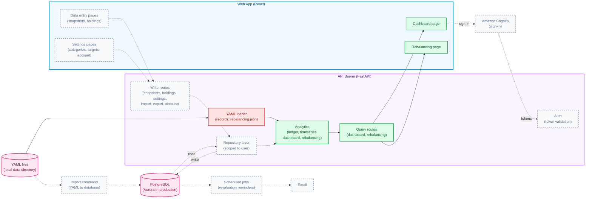
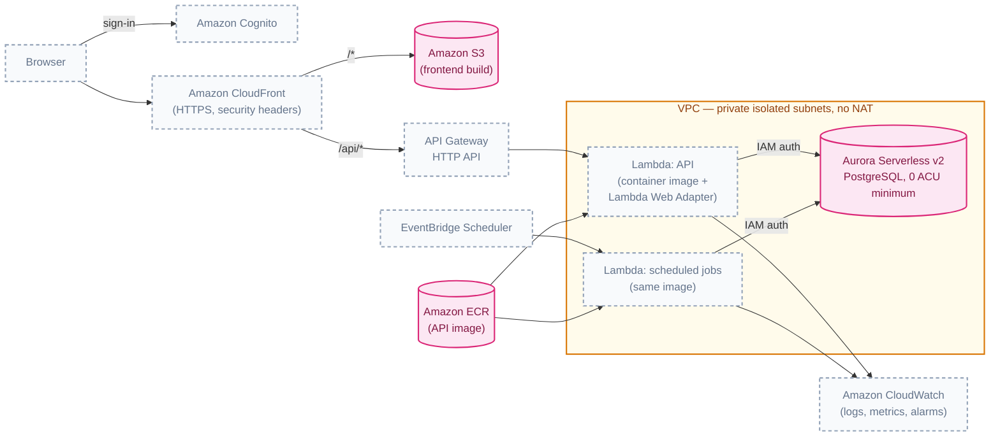

# Net Worth Dashboard

**High-Level Software Architecture**
**Version:** 0.1
**Status:** Proposed

This is the target architecture. The diagrams mark which parts are already
implemented; [the roadmap](../roadmap.md) describes how the project gets to the
rest. Technology choices are justified in [the studies](../studies/).

## Application Diagram

Solid green boxes and arrows are implemented; dashed grey boxes and dotted
arrows are planned; the red box is implemented but will be replaced. Arrows
show the direction data flows. Auth guards every API route.

## Deployment Diagram (AWS)

The whole deployment is planned. All infrastructure is defined in AWS CDK.

## Components

| Component | Responsibilities | Reads | Writes | Status |
|---|---|---|---|---|
| **Web App** | Display dashboard and rebalancing; enter snapshots and holdings; edit settings; sign in | API Server, Cognito | API Server | ✅ Dashboard, rebalancing · 🔲 Data entry, settings, sign-in |
| **Query routes** | Build the dashboard and rebalancing payloads | Analytics | — | ✅ Implemented |
| **Write routes** | Create, update, and delete user data; import; export; delete account | Repository | Repository | 🔲 Planned |
| **Auth** | Validate tokens and resolve the current user for every route | Cognito signing keys | — | 🔲 Planned |
| **Analytics** | Pure functions over validated models: totals, interpolation, history, allocation, rebalancing | Records (from YAML loader or repository) | — | ✅ Implemented |
| **YAML loader** | Load and validate records and `rebalancing.json` from files | YAML files | — | ⚠️ To be replaced by the repository |
| **Repository layer** | All database access; every query takes the user ID | PostgreSQL | PostgreSQL | 🔲 Planned |
| **Import command** | Load existing YAML records and rebalancing settings into the database | YAML files | PostgreSQL | 🔲 Planned |
| **Scheduled jobs** | Send revaluation reminders | PostgreSQL | Email | 🔲 Planned |

## API Resources

| Resource | Methods | Purpose | Status |
|---|---|---|---|
| `/api/health` | GET | Health check | ✅ Implemented |
| `/api/dashboard` | GET | Summary, history, allocation, holdings, movement | ✅ Implemented |
| `/api/rebalancing` | GET | Rebalancing result for the latest snapshot | ✅ Implemented |
| `/api/rebalancing/settings` | GET, PUT | Read and replace the rebalancing settings (buckets, reserves, exclusions, fill order) in one transaction | 🔲 Planned |
| `/api/snapshots` | GET, POST, PUT, DELETE | Dated snapshots with holding and liability values | 🔲 Planned |
| `/api/holdings` | GET, POST, PUT | Holdings and their linked mortgages | 🔲 Planned |
| `/api/liabilities` | GET, POST, PUT | Standalone liabilities | 🔲 Planned |
| `/api/categories` | GET, POST, PUT | Categories and disposable-value exclusions | 🔲 Planned |
| `/api/import`, `/api/export` | POST, GET | YAML/CSV import; JSON/CSV export | 🔲 Planned |
| `/api/account` | GET, DELETE | Preferences; account deletion | 🔲 Planned |

## Data Model

| Entity | Key fields | Notes |
|---|---|---|
| `users` | id, identity provider subject, locale, currency | One row per Cognito user |
| `categories` | id, user, name, excluded from disposable value, excluded from rebalancing | Replaces the `EXCLUDED_CATEGORY` constant and `excluded_categories` |
| `holdings` | id, user, name, category, liquidity | Identity kept across snapshots; can be closed |
| `liabilities` | id, user, name, linked holding (optional) | A mortgage is a liability linked to a property |
| `snapshots` | id, user, date | Unique date per user |
| `snapshot_values` | snapshot, holding or liability, amount | Amounts as `NUMERIC(14, 2)` |
| `rebalancing_buckets` | id, user, parent bucket (optional), name, weight, fill position (optional) | Tree of buckets; weights are relative among siblings |
| `rebalancing_bucket_members` | bucket, category or holding | What a leaf bucket may hold |
| `rebalancing_reserves` | id, user, name, amount, fill position (optional) | Fixed amounts filled before the pool |
| `rebalancing_reserve_categories` | reserve, category | Categories a reserve may draw from |

Every table carries the owning user, directly or through its parent, and is
protected by row-level security.

Rebalancing settings are stored in tables rather than as a JSON document, so
foreign keys keep references to categories and holdings valid when they are
renamed or closed. Rules that span rows (positive weights, every leaf bucket
has members, unique fill positions across reserves and buckets) are checked
by the API with the existing Pydantic model before saving. `rebalancing.json`
is only read once, by the import command.

## Environments

| Environment | Frontend | API | Database | Status |
|---|---|---|---|---|
| **Local (current)** | Vite dev server on the host | uvicorn on the host (`run-dev.sh`) | YAML files | ✅ Implemented |
| **Local (compose)** | Vite dev server in a compose service | API container (uvicorn) | PostgreSQL container (unused until Phase 5) | ✅ Implemented |
| **CI** | Lint, type check, tests, build | Lint, type check, tests, image build and smoke test | PostgreSQL container from Phase 5 | ✅ Implemented |
| **Staging** | S3 + CloudFront | Lambda + HTTP API | Aurora Serverless v2 | 🔲 Planned |
| **Production** | S3 + CloudFront | Lambda + HTTP API | Aurora Serverless v2 | 🔲 Planned |

## External Systems

| System | Type | Purpose | Status |
|---|---|---|---|
| **PostgreSQL / Aurora Serverless v2** | Data storage | Users' financial data and settings | 🔲 Planned |
| **Amazon Cognito** | Identity | Sign-up, sign-in, password reset | 🔲 Planned |
| **Amazon S3 + CloudFront** | Hosting | Frontend build; single origin for the app and the API | 🔲 Planned |
| **Email provider** | Notifications | Revaluation reminders | 🔲 Planned |

## Architectural Principles

- **Analytics independent of storage:** the analytics are pure functions over
  validated Pydantic models. Moving from YAML to PostgreSQL changes only where
  the models come from, and the existing tests keep checking the results.
- **User isolation in depth:** the repository layer requires the user ID on
  every query; PostgreSQL row-level security enforces the same rule if the
  application gets it wrong; tests try to read across users.
- **Exact money:** amounts are `Decimal` in Python and `NUMERIC` in
  PostgreSQL, never floating point.
- **Stateless API:** the API keeps no state between requests and runs no work
  after responding, so it runs unchanged under uvicorn locally and on Lambda.
- **Let the database sleep:** connections are closed when idle (`NullPool` on
  Lambda, no RDS Proxy), and the API and UI tolerate the resume delay after
  Aurora pauses.
- **No outbound internet from the VPC:** IAM database authentication and token
  validation without outbound calls avoid paying for a NAT gateway or VPC
  endpoints.
- **Single origin:** CloudFront serves the frontend and routes `/api/*` to the
  API, so there is no CORS in production.
- **No personal data outside the database:** financial data never enters the
  repository, container images, or logs; development and tests use a
  fictitious sample dataset.
- **Same artifacts everywhere:** one API image runs locally, in CI, and on
  Lambda; one frontend build is tested in staging and deployed to production.
- **Containers:** each service runs in its own Podman container locally, with
  separate build and runtime stages.
- **Infrastructure:** AWS CDK manages all infrastructure, with staging and
  production built from the same code.

## Open Design Questions

- Choose how the browser sends credentials (cookie or `Authorization`
  header), and how tokens are validated without an outbound call (API Gateway
  JWT authorizer or signing keys provided at deploy time).
- Choose how scheduled jobs send email without outbound internet from the VPC
  (for example, a job outside the VPC that receives the reminder list, or an
  Amazon SES VPC endpoint), and compare the costs.
- Decide how Alembic migrations run in staging and production (a migration
  function invoked by CI, or a CDK custom resource).
- Decide whether to support several currencies per user, or one currency per
  user for the first release.
- Decide whether to switch the frontend from hash-based to path-based routing;
  path-based routing needs the SPA fallback described in the frontend runtime
  study, hash-based does not.
