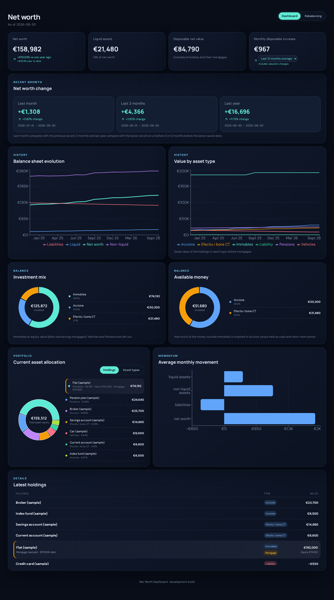
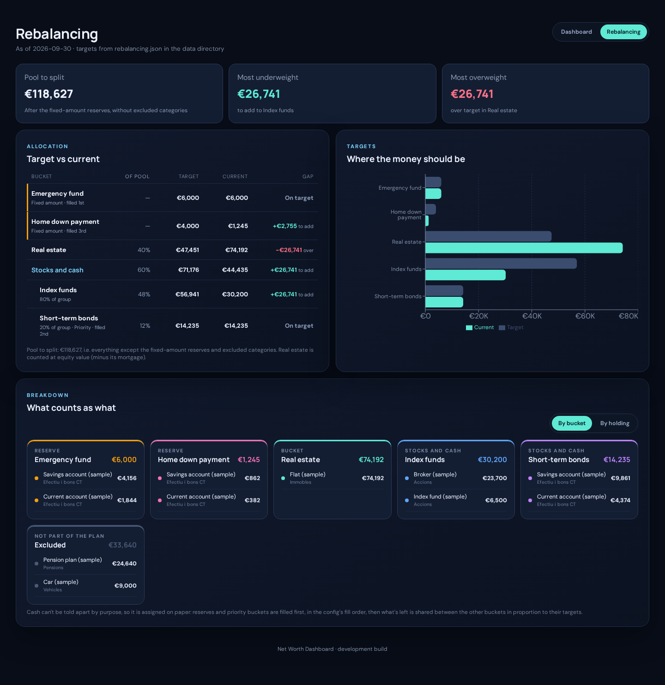
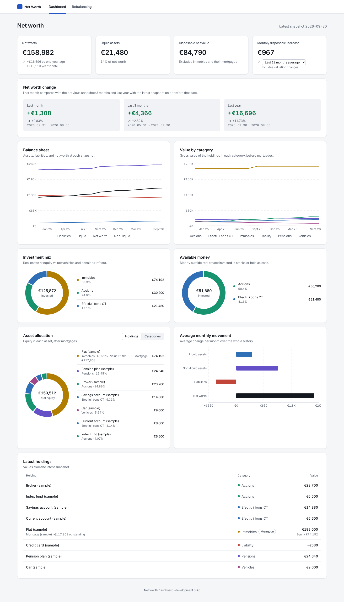
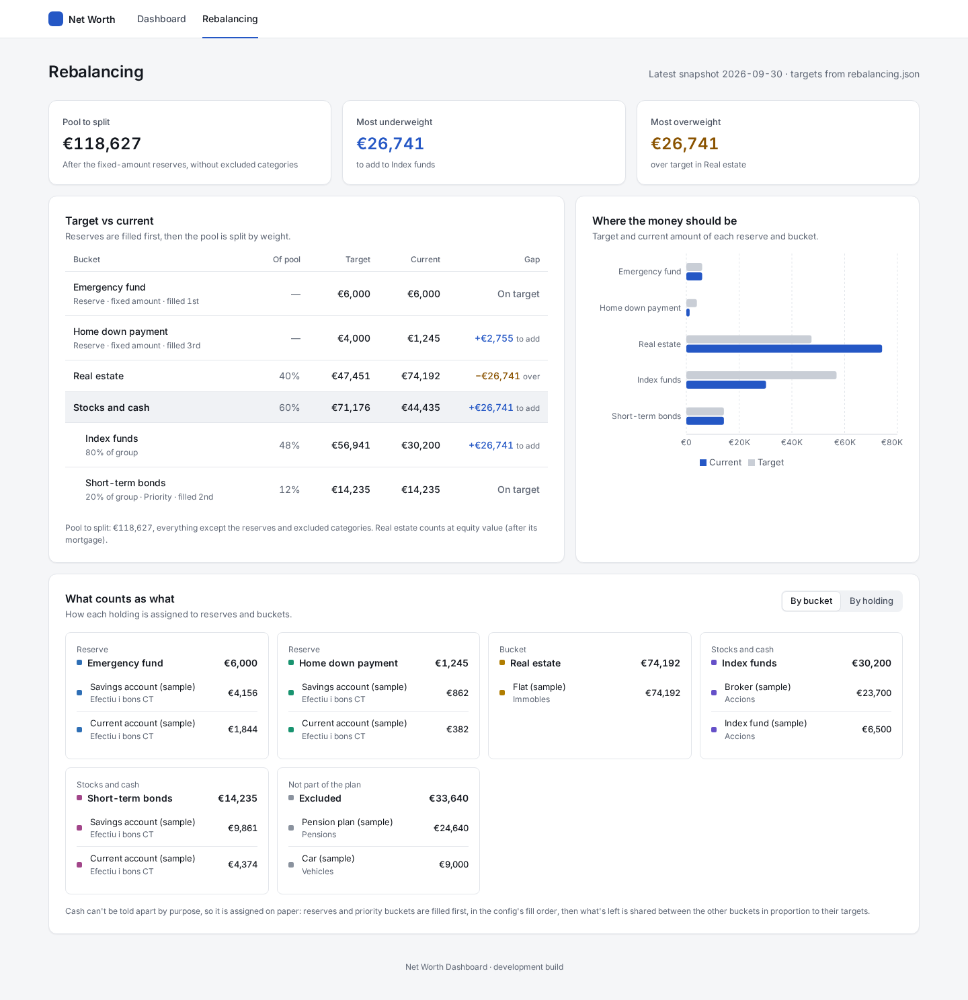
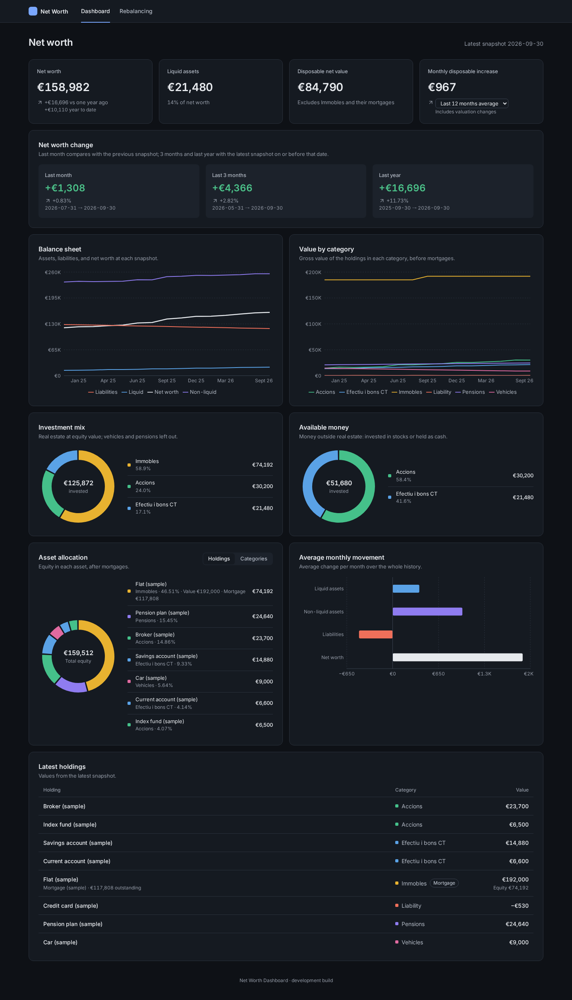
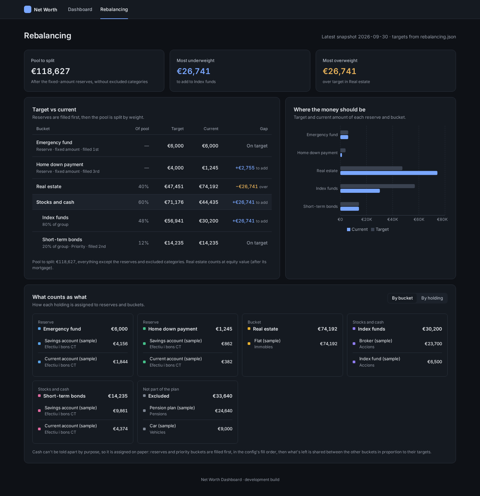
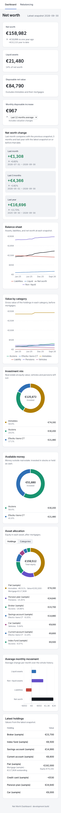

# Net Worth Dashboard

**Visual Design System**
**Version:** 0.1
**Status:** Implemented on the Dashboard and Rebalancing pages

This document defines the visual language of the web app: colours, typography, spacing,
components, and the conventions for numbers. New pages must use these tokens and
components rather than introduce their own. The tokens live in
[`frontend/src/styles.css`](../../frontend/src/styles.css); chart colours are exposed to
TypeScript in [`frontend/src/lib/theme.ts`](../../frontend/src/lib/theme.ts).

## 1. Principles

- **Calm and factual.** Flat surfaces, thin borders, one accent colour. No gradients, glows,
  coloured edge bars, or uppercase labels.
- **Colour carries meaning, never decoration.** Green and red are reserved for gains and
  losses; each category has one fixed colour in every chart.
- **Numbers first.** Figures are the largest text on the page, in tabular digits, with one
  convention for signs.
- **Accessible by default.** WCAG AA contrast in both themes, colour-blind-safe charts,
  visible keyboard focus, and reduced motion respected.

## 2. Themes

Light is the default; dark applies when the operating system prefers it
(`prefers-color-scheme: dark`). Both themes use the same token names, so components never
reference a theme directly. `color-scheme: light dark` makes native controls (selects,
scrollbars) follow the theme.

## 3. Colour Tokens

| Token | Light | Dark | Use |
|---|---|---|---|
| `--color-bg` | `#f5f6f8` | `#0e1116` | Page background |
| `--color-surface` | `#ffffff` | `#151a21` | Panels, cards, top bar |
| `--color-surface-muted` | `#f0f2f5` | `#1c222b` | Nested cards, group rows, segmented track |
| `--color-border` | `#e2e5ea` | `#2a313c` | Panel borders, table rules, chart grid |
| `--color-border-strong` | `#c9ced6` | `#3a4250` | Inputs, tags, axes, target bars |
| `--color-text` | `#14181f` | `#e7eaee` | Primary text, figures |
| `--color-text-muted` | `#4a5260` | `#b0b7c2` | Labels, secondary text |
| `--color-text-subtle` | `#5f6775` | `#949ba7` | Descriptions, dates, footnotes |
| `--color-accent` | `#2457c5` | `#7aa7ff` | Links, active navigation, focus, "current" bars, money to add |
| `--color-positive` | `#0e7a4b` | `#4cc38a` | Gains only |
| `--color-negative` | `#c23b31` | `#f07a70` | Losses only |
| `--color-warning` | `#8a5300` | `#e9b35a` | Over target, notices that need attention |

## 4. Chart Colours

A six-colour categorical palette, chosen by search to stay distinguishable under the three
common colour-vision deficiencies, with each colour at least 3:1 against the panel
background. Each hue is the same family in both themes, so a category does not change
colour when the theme changes.

| Token | Light | Dark | Fixed use |
|---|---|---|---|
| `--chart-1` blue | `#2f6fb5` | `#5aa2e6` | Cash and short-term bonds; liquid assets |
| `--chart-2` green | `#18936f` | `#45c08a` | Stocks |
| `--chart-3` ochre | `#b07d00` | `#e8b230` | Real estate |
| `--chart-4` red | `#c2453a` | `#ef6f5a` | Liabilities |
| `--chart-5` magenta | `#a2468a` | `#e06aa0` | Vehicles |
| `--chart-6` violet | `#6550c8` | `#8f7cf0` | Pensions; non-liquid assets |
| `--chart-neutral` | `#8a929e` | `#7d8592` | Excluded or "other" |

Rules:

- **Categories** use `categoryColor(name)`: a fixed colour for known categories, and a
  stable colour derived from the name for new ones. Holdings take their category's colour.
- **Balance sheet series** use the matching category colours; net worth uses the text
  colour, drawn thicker.
- **Rebalancing slices** (user-defined reserves and buckets) cycle through the palette
  without red, which would read as a loss.
- **Target vs current** bars use `--color-border-strong` for target and the accent for
  current.

## 5. Numbers and Changes

| Rule | Example |
|---|---|
| Tabular figures everywhere (`font-variant-numeric: tabular-nums`) | Columns of amounts align |
| Amounts right-aligned in tables and lists | |
| Negative amounts use a true minus sign (U+2212), written as the escape `−` in source | −€530 |
| Changes always carry a sign; zero has none | +€1,308, −€530, €0 |
| Gains in `--color-positive`, losses in `--color-negative`, no change neutral | |
| Rebalancing gaps are not gains or losses: money to add uses the accent, over target uses the warning colour | +€2,755 to add, −€26,741 over |

All formatting goes through [`frontend/src/lib/format.ts`](../../frontend/src/lib/format.ts);
components do not format numbers themselves.

## 6. Typography

[Inter](https://rsms.me/inter/) (variable), self-hosted through `@fontsource-variable/inter`,
so no request goes to an external font service. System fonts are the fallback.

| Token | Size | Use |
|---|---|---|
| `--font-size-2xl` | 28px | Headline figures in metric cards |
| `--font-size-xl` | 24px | Page titles, summary figures |
| `--font-size-lg` | 16px | Panel titles, donut totals |
| `--font-size-md` | 14px | Body text, table rows |
| `--font-size-sm` | 13px | Labels, descriptions, controls |
| `--font-size-xs` | 12px | Footnotes, table headings, secondary lines |

Weights: 400 (text), 500 (labels, amounts in tables), 600 (titles, headline figures).

## 7. Spacing, Shape, and Depth

- **Spacing:** a 4px grid: `--space-1` (4px) to `--space-10` (40px). Panels use 24px
  padding and 16px gaps.
- **Radii:** `--radius-sm` 6px (controls), `--radius-md` 8px (nested cards), `--radius-lg`
  12px (panels), `--radius-pill` for tags.
- **Shadows:** `--shadow-sm` on panels in the light theme only; `--shadow-md` for tooltips.
  The dark theme relies on borders.

## 8. Components

| Component | Description |
|---|---|
| Top bar | Product name and main navigation; the current page is underlined in the accent colour |
| Page header | Page title, with the snapshot date at the right |
| `Panel` | Surface with a title, an optional one-line description, and optional actions (such as a view toggle) at the right |
| `MetricCard` | Label, headline figure, and a change line with a trend arrow |
| Summary card | Muted card inside a panel, for a figure with its context |
| `SegmentedControl` | Neutral track; the selected option is a raised surface, not a coloured pill |
| `Swatch` | 8px square identifying a category or series next to its label |
| Tag | Outlined pill for a status, such as "Mortgage" |
| Notice | Warning-tinted bar for something that needs attention |
| Tables | Small, regular-case headings; rows separated by single rules; figures right-aligned |

## 9. Accessibility

| Check | Result |
|---|---|
| Text contrast, both themes, on every background | Lowest 4.72:1 (light) and 5.72:1 (dark); AA requires 4.5:1 |
| Chart colours against panels | All at least 3:1 (WCAG non-text contrast) |
| Chart colours under simulated protanopia, deuteranopia, tritanopia | Closest pair at CIELAB distance 15.3 (light) and 13.9 (dark); 10 is the minimum |
| axe-core, WCAG 2.0, 2.1, 2.2 A and AA rules | 0 violations on both pages, in both themes |
| Keyboard focus | Every focusable element shows a 2px accent outline (`:focus-visible`) |
| Motion | The loading spinner stops when the system asks for reduced motion |

`python3 scripts/check_design_tokens.py` re-runs the contrast and colour-blindness checks
against the tokens in `styles.css`; CI runs it on every pull request.

## 10. Before and After

Screenshots use the fictitious sample data.

**Before**

**After: light theme**

**After: dark theme**

**After: mobile (390px)**

